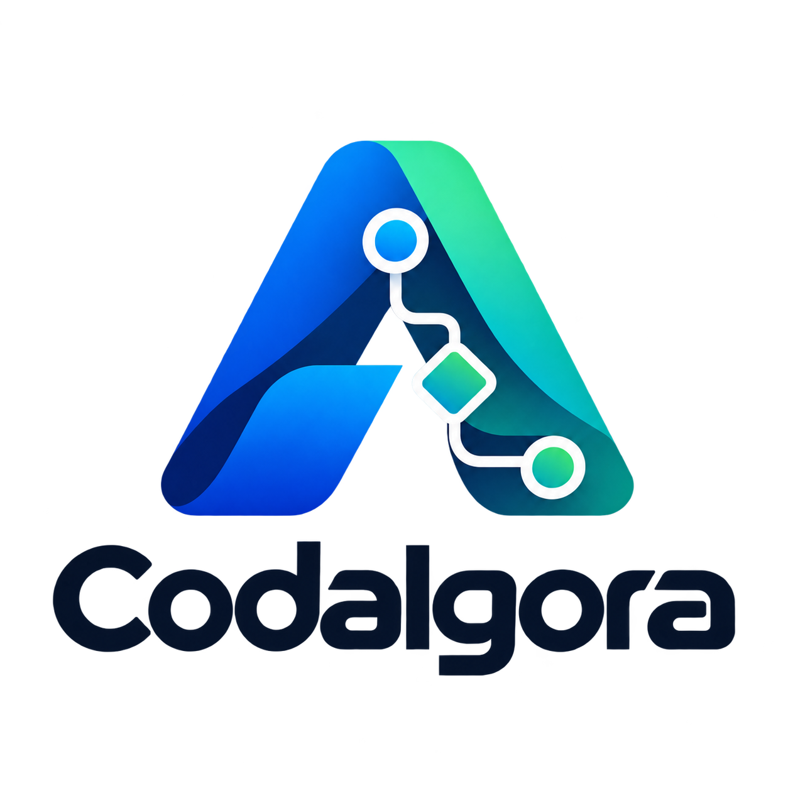
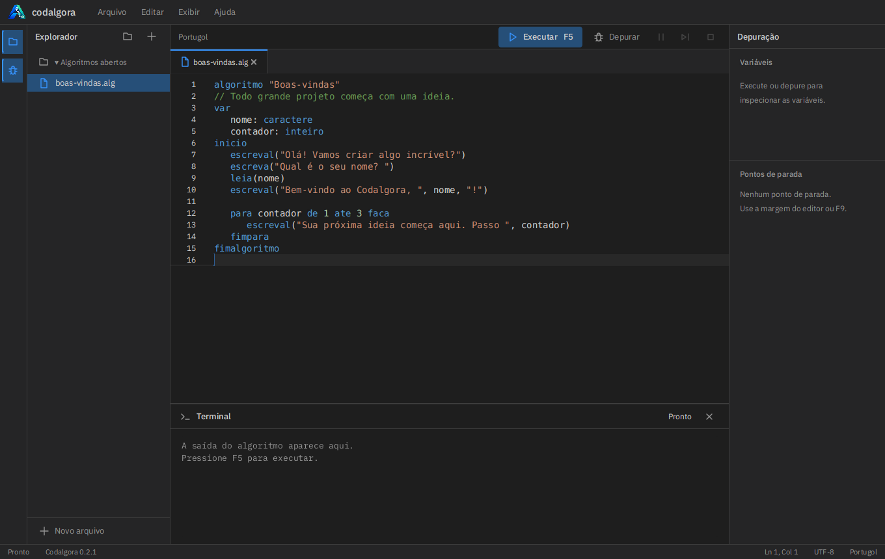

# Codalgora


> **Versão beta:** o Codalgora está em desenvolvimento ativo e pode apresentar bugs ou comportamentos inesperados. A distribuição v0.2.1 disponibiliza instaladores após os workflows Linux e Windows validarem os artefatos.

<p align="center">
  
</p>

**Codalgora — IDE educacional para escrever, executar e depurar algoritmos em Portugol.** Desenvolvida para **Linux e Windows**, com interpretador próprio para arquivos `.alg` do dialeto VisualG.

Idealizado e desenvolvido por **Arthur Almeida**, o Codalgora é um projeto pessoal criado para oferecer uma IDE moderna e acessível a estudantes de lógica de programação. Seu objetivo é unir simplicidade, aprendizado e uma experiência de desenvolvimento que acompanhe os primeiros passos na programação.

O projeto está em fase beta. O fluxo de publicação da v0.2.1 gera e valida os instaladores Linux e Windows antes de disponibilizar os downloads.

O projeto usa **Java 21, JavaFX 21, ANTLR4 e RichTextFX**, com **Gradle Kotlin DSL**, testes **JUnit 5** e distribuição nativa via **jpackage**.

A interface reúne editor com abas e realce de sintaxe, entrada e saída do algoritmo, autocompletar e depurador com pontos de parada e inspeção de variáveis. O núcleo da linguagem permanece independente da interface gráfica. Para informações sobre os recursos do dialeto VisualG atendidos pelo Codalgora, consulte a [matriz de compatibilidade](docs/compatibilidade.md) e o [levantamento Java](interpreter/compatibility-survey.md).



A interface utiliza fontes IBM Plex locais, painéis recolhíveis e composição adaptada a janelas compactas. Veja a [direção visual](docs/design-interface.md), a [visualização compacta](docs/assets/codalgora-compacto.png) e o [registro de verificação](docs/verificacao.md).

## Downloads

Os links diretos dos instaladores v0.2.1 são ativados pela publicação da release, depois que os workflows validam os pacotes e seus checksums:

- **Windows x64:** [MSI (recomendado)](https://github.com/thurdass/Codalgora/releases/download/v0.2.1/Codalgora-0.2.1.msi) ou [EXE](https://github.com/thurdass/Codalgora/releases/download/v0.2.1/Codalgora-0.2.1.exe).
- **Linux x64 (Debian/Ubuntu):** [pacote DEB](https://github.com/thurdass/Codalgora/releases/download/v0.2.1/codalgora_0.2.1_amd64.deb); instale com `sudo apt install ./codalgora_0.2.1_amd64.deb`.
- [Checksums SHA-256](https://github.com/thurdass/Codalgora/releases/download/v0.2.1/SHA256SUMS.txt).

Os instaladores incluem o runtime Java; não é necessário instalar um JDK para usar a IDE. O pacote Linux é destinado a distribuições compatíveis com `.deb`.

Os arquivos da release histórica [Algora v0.2.0](https://github.com/thurdass/Codalgora/releases/tag/v0.2.0) permanecem disponíveis sem alterações e ainda exibem a identidade antiga.

## Executar a partir do código

Instale um JDK 21 completo. O Gradle Wrapper baixa as dependências na primeira execução.

```sh
./gradlew test
./gradlew :desktop:run
./gradlew :cli:run --args='examples/ola.alg'
```

No Windows, substitua `./gradlew` por `.\gradlew.bat`. Os exemplos originais em `examples/` incluem entrada de dados, fatorial e vetores. O terminal integrado recebe valores de `leia` e apresenta a saída; não é um shell do sistema operacional.

## Usar a IDE

| Atalho | Ação |
| --- | --- |
| `Ctrl+N`, `Ctrl+O`, `Ctrl+S` | Novo arquivo, abrir e salvar |
| `Ctrl+Espaço` | Sugestões de palavras e modelos de estruturas |
| `Ctrl+B` | Mostrar ou ocultar arquivos |
| `Ctrl+Shift+D` | Mostrar ou ocultar depuração |
| `F5` | Executar ou continuar |
| `F9` | Alternar ponto de parada na linha atual |
| `F10` | Avançar uma instrução |

Também é possível marcar pontos de parada na margem esquerda do editor. Os controles permitem iniciar depuração, pausar e interromper. A abertura tenta UTF-8 e usa Windows-1252 para arquivos legados; o salvamento escreve UTF-8.

## Gerar distribuição

```sh
./gradlew :desktop:jpackageAppImage
./gradlew :desktop:jpackageInstaller
```

`jpackageAppImage` gera uma pasta de aplicação com runtime Java incluído, correspondente ao tipo `app-image` do JDK. Não gera um arquivo Linux `.AppImage`. `jpackageInstaller` gera o instalador nativo do sistema onde o build é executado. Linux e Windows exigem builds e validação próprios. Veja [instalação](docs/instalacao.md) para requisitos e limitações.

## Organização

- `interpreter`: gramática ANTLR4, AST, execução e API de depuração, sem dependência gráfica.
- `desktop`: aplicação JavaFX 21 e editor RichTextFX, organizados em documentos, editor, terminal, depuração, execução e componentes visuais. Veja o [relatório da refatoração estrutural](docs/refatoracao-estrutural.md).
- `cli`: execução de algoritmos no terminal usando o mesmo interpretador.
- `examples`: programas originais para experimentar.
- `docs`: arquitetura, API, compatibilidade e evidências da investigação.


Consulte a [arquitetura](docs/arquitetura.md), a [API Java](docs/api.md) e o [relatório REA](docs/engenharia-reversa.md). O Codalgora foi implementado de forma independente. O executável, recursos e código proprietário do VisualG não são distribuídos. A análise estática do original não comprova equivalência integral de comportamento.

Repositório: [thurdass/Codalgora](https://github.com/thurdass/Codalgora). Os commits seguem Conventional Commits.


### Aparência

Escolha entre seis temas em **Exibir → Tema de cores**: Grafite, Dracula, Nord, Solarizado escuro, Claro e Solarizado claro. A preferência é salva automaticamente. O layout segue as referências do IntelliJ e VS Code, com barras compactas e atalhos laterais para os painéis. Consulte [o guia visual](docs/design-interface.md).
