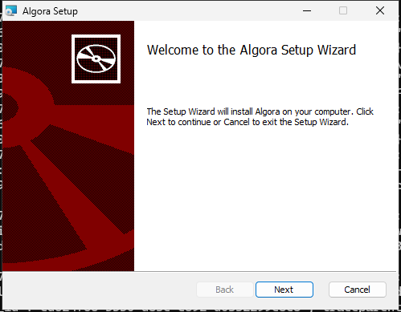

# Verificação Java 21

Data: 20/10/2026. Código validado: `a32b765ac2236223e21a62cf52a731214743a049`.

A [execução de CI](https://github.com/thurdass/Algora/actions/runs/39520018378) terminou com sucesso nos runners `ubuntu-latest` e `windows-latest`. Foram usados JDK 21, JavaFX 21.0.13, ANTLR 4.13.2, RichTextFX 0.11.7, Gradle 9.7.1 e JUnit 5.11.4. A interface redesenhada usa fontes IBM Plex distribuídas localmente e ícones vetoriais nativos. Não há dependência de Node.js, Electron ou Monaco no aplicativo Java.

## Testes

| Módulo | Testes JUnit 5 |
| --- | ---: |
| Interpretador | 14 |
| CLI | 3 |
| Interface JavaFX/RichTextFX | 5 |
| Total | 22 |

Na verificação local, todos passaram, sem falhas nem testes ignorados. O build e os testes gráficos também passaram nos dois sistemas da CI.

O núcleo cobre análise ANTLR e AST, entradas tipadas, vetores e limites, controle de fluxo, constantes, recursão, escopos, funções, formatação, depuração e cancelamento de entrada bloqueada. A CLI verifica entrada redirecionada, EOF, erros e Windows-1252. Os testes JavaFX exercitam entrada e saída interativas, pausa/passo/parada, recuperação após erro, autocompletar, pontos de parada e recolhimento dos painéis em janelas compactas.

## Pacotes nativos

`jpackageInstaller` gerou `.deb` no Linux e `.exe` no Windows. `jpackageSmokeTest` iniciou a aplicação nativa em cada sistema, usando o runtime incluído, enviou entrada pelo terminal e verificou a saída e o encerramento do algoritmo. O teste terminou com `ALGORA_SMOKE_OK` nos dois ambientes.

Os instaladores e relatórios JUnit estão nos artefatos da execução de CI. O teste de execução usa a pasta `app-image` que alimenta o instalador; não automatiza o assistente de instalação nem verifica todas as distribuições Linux, configurações de fontes ou versões de Windows.

Para reproduzir em Linux com suporte gráfico virtual:

```sh
xvfb-run -a ./gradlew build :desktop:jpackageInstaller :desktop:jpackageSmokeTest
```

No Windows, com JDK 21 e WiX 3 disponíveis:

```powershell
.\gradlew.bat build :desktop:jpackageInstaller :desktop:jpackageSmokeTest
```

## Compatibilidade da linguagem

O [levantamento Java](../interpreter/compatibility-survey.md) aceitou 58 de 73 arquivos locais no parser. Foram executados casos específicos de fatorial e ordenação. Esses números não demonstram equivalência integral com o VisualG, cujo runtime não foi executado como oráculo. Os recursos ausentes continuam registrados na [matriz de compatibilidade](compatibilidade.md).

## Atualização: temas e referências de IDE

Em 20/10/2026, a suíte passou com 23 testes (14 interpretador, 3 CLI, 6 interface). Os seis temas são exercitados com aplicação de CSS, persistência e capturas. O build Linux, instalador `.deb` e execução do aplicativo empacotado passaram (`ALGORA_SMOKE_OK`). A validação Windows desta alteração será registrada pelo workflow do commit correspondente; a validação Windows citada acima pertence à revisão anterior.

O workflow [39521317453](https://github.com/thurdass/Algora/actions/runs/39521317453) confirmou a revisão `b21f652` em Linux e Windows: 23 testes e teste de execução nativa aprovados. Seus instaladores são a origem dos artefatos da release `v0.2.0`; a alteração seguinte adiciona somente logo e documentação. A release acompanha hashes SHA-256.


### Release atualizada com a logo

A release `v0.2.0` foi atualizada com os artefatos da revisão `9d0c9dd`, produzidos pelo [workflow 39522744399](https://github.com/thurdass/Algora/actions/runs/39522744399). Linux e Windows passaram na suíte e na execução do aplicativo empacotado. Os novos instaladores incluem a logo no cabeçalho e acompanham hashes SHA-256 renovados.

### Ícones nativos do aplicativo

A revisão `78168a8` configura o emblema oficial no `jpackage` e na janela JavaFX. O [workflow 39528828461](https://github.com/thurdass/Algora/actions/runs/39528828461) passou em Linux e Windows, incluindo build, 23 testes e execução empacotada. No Linux, o PNG da aplicação e o PNG extraído do `.deb` foram comparados ao recurso original e são idênticos; o arquivo `.desktop` aponta para esse ícone. O ICO Windows contém resoluções de 16 a 256 pixels. Os instaladores atualizados substituem os da release `v0.2.0` e recebem novos hashes SHA-256.

### Associação da janela ao dock e instalação Windows

A janela JavaFX foi inspecionada com `xprop`: `WM_CLASS` é `io.algora.desktop.AlgoraApplication` e `_NET_WM_ICON` já existia. O atalho do pacote anterior não declarava `StartupWMClass`. O template Linux agora inclui a classe correspondente. O teste `desktop/packaging/tests/verify-linux-desktop.py` extrai o `.deb`, abre seu executável e compara a classe nativa ao atalho, além de conferir a presença do ícone.

O [workflow 39530990646](https://github.com/thurdass/Algora/actions/runs/39530990646), revisão `65d6bcc`, aprovou os testes das duas plataformas. No Windows, o novo teste `verify-windows-installer.ps1` instalou o `.exe` silenciosamente, consultou o estado pelo Windows Installer, verificou os atalhos, executou o aplicativo instalado e o desinstalou. Os marcadores são `ALGORA_WINDOWS_INSTALL_OK` e `ALGORA_WINDOWS_UNINSTALL_OK`. A primeira versão desse teste falhou por presumir um caminho de Registro específico; os logs já indicavam instalação bem-sucedida, e a consulta foi corrigida para usar a API MSI.

A falha Windows relatada pelo usuário não foi reproduzida nesse ambiente; sua mensagem e etapa ainda são necessárias para diagnóstico específico. O teste silencioso não cobre os diálogos interativos, SmartScreen ou políticas de outra máquina. Os instaladores e hashes da release `v0.2.0` foram atualizados para esta revisão.

### Assistente visível e MSI Windows direto

O relato foi esclarecido: no Windows 11, o instalador `.exe` baixado permanecia em execução sem mostrar a tela. A distribuição passou a incluir também `Algora-0.2.0.msi`, recomendado para abrir diretamente o Windows Installer, sem a extração intermediária feita pelo `.exe`. Não houve alteração no código Java ou nas regras da linguagem.

O [workflow 39535004943](https://github.com/thurdass/Algora/actions/runs/39535004943), revisão `8875281`, passou em Linux e Windows. Além dos 23 testes e da execução empacotada, o Windows confirmou, para `.exe` e `.msi`: assistente nativo visível com controles de navegação e dimensões válidas; captura da janela; cancelamento; instalação silenciosa; atalhos; execução da aplicação instalada; e desinstalação. Os logs e capturas estão no artefato `Windows-installer-diagnostics`.

A automação inicial via UI Automation não detectava corretamente as janelas MSI; a verificação passou a usar janelas e controles Win32. O encerramento precisou acionar o botão Cancel, em vez de depender apenas de WM_CLOSE. Essas falhas foram do teste, não demonstraram defeito nos instaladores. As capturas finais mostram os dois assistentes; a falha específica da máquina Windows 11 do usuário não foi reproduzida no runner Windows Server 2025. O MSI direto fornece uma alternativa que evita o executável intermediário, sem atribuir uma causa não confirmada ao ambiente do usuário.



### Rebranding para Codalgora

Na revisão local do rebranding, `./gradlew clean test assemble` passou com 23 testes: 14 do interpretador, 3 da CLI e 6 da interface. `xvfb-run -a ./gradlew :desktop:jpackageSmokeTest` passou com `CODALGORA_SMOKE_OK`, e `xvfb-run -a ./gradlew :desktop:jpackageInstaller` gerou o instalador `.deb` em Linux. A verificação adicional do atalho Linux não concluiu porque `xwininfo` não conseguiu acessar o display virtual neste ambiente. A validação de MSI/EXE no Windows não foi executada.

Os registros anteriores deste documento conservam URLs, nomes de artefatos, classes e marcadores da identidade Algora, pois descrevem resultados dessas revisões. O caminho Java Preferences `/io/algora/desktop` também permanece intencionalmente para preservar temas já salvos pelos usuários.

### Validação dos instaladores Codalgora v0.2.1

O commit `dc2b909` passou no [workflow de push 44573487692](https://github.com/thurdass/Codalgora/actions/runs/44573487692) e no [workflow do PR #2 44573502524](https://github.com/thurdass/Codalgora/actions/runs/44573502524), nos runners `ubuntu-latest` e `windows-latest`. Cada runner executou `build`, os 23 testes JUnit, `jpackageInstaller` e `jpackageSmokeTest` com runtime incluído.

No Linux, o `.deb` gerado foi instalado pelo `apt`, consultado como pacote `codalgora` na versão efetiva do build e iniciado sob display virtual. O teste conferiu o nome Codalgora no lançador registrado no menu, o ícone, `StartupWMClass` e o título da janela. A desinstalação removeu o aplicativo e o atalho; um marcador no caminho legado de preferências `/io/algora/desktop` permaneceu.

No Windows, os runners geraram MSI e EXE. Os dois assistentes visíveis foram conferidos quanto ao nome Codalgora; cada pacote foi instalado, teve os atalhos do Desktop e Menu Iniciar verificados, iniciou a aplicação instalada com `--smoke-test` e foi desinstalado. O teste também conferiu `ProductName=Codalgora`, `ProductVersion` igual à versão efetiva do Gradle, o título real da janela e o ícone incorporado ao executável. Logs e capturas do assistente estão no artefato `Windows-installer-diagnostics` da execução.

Cada runner gerou `SHA256SUMS.txt` para seus instaladores. A publicação oficial usa os artefatos produzidos em um workflow da tag `v0.2.1`, recompõe um checksum único para o `.deb`, MSI e EXE, confere os hashes e só então cria a release. Isso mantém a release histórica `v0.2.0` inalterada.

Durante a validação, uma checagem X11 testava incorretamente o texto do `xprop`; outra execução encontrou a ausência de diretórios de menu no runner headless e a falta de remoção do atalho pelo pacote Debian gerado. A verificação do ícone foi corrigida, o runner passou a preparar os diretórios padrão de menu e foi incluído um `prerm` para desregistrar o lançador. As execuções finais acima passaram com essas correções.

### Teste manual do aplicativo exportado pelo GUI Builder

Em 19/11/2026, o usuário testou `codalgora-visual-app.zip` em desktop Linux com sessão gráfica: extraiu em `/tmp/codalgora-gui-test`, executou `chmod +x Executar.sh` e iniciou com `./Executar.sh`. A janela JavaFX abriu fora da IDE. Quatro cliques no botão executaram o procedimento Portugol e imprimiram `1`, `2`, `3`, `4`, confirmando o fluxo básico de evento e estado global compartilhado durante a sessão. O usuário também observou o aviso JavaFX de classes carregadas do módulo sem nome; ele não bloqueou a execução.

O empacotamento atual usa `jpackage` com `--input`/`--main-jar` e dependências JavaFX no classpath, o que explica o módulo sem nome. Não foi feita migração para module path: isso requer modularizar/verificar a aplicação e suas dependências, e o aviso não afetou a execução observada. Esta anotação registra o relato manual do usuário; não equivale a um teste automatizado reproduzível.

Na validação manual original, somente a inicialização do ZIP e quatro eventos de botão foram observados. Os testes automatizados e a reabertura em Xvfb descritos na seção seguinte ampliam essa cobertura, mas não substituem o teste manual de fechamento gracioso, persistência de valores entre processos, outras distribuições Linux ou Windows. A compatibilidade VisualG continua limitada ao escopo do levantamento acima; não há comparação integral automatizada com o VisualG como oráculo.

### Estabilização local do GUI Builder

Em 19/11/2026, `xvfb-run -a ./gradlew clean test assemble` terminou com sucesso: 39 testes (19 interpretador, 3 CLI e 17 desktop, incluindo 12 testes JavaFX). A suíte JavaFX verificou 100 ativações rápidas em ordem, estado global, vínculos de campo de texto/checkbox/lista, exibição de erro de divisão por zero, cancelamento de laço infinito sem bloquear o thread JavaFX, reconstrução dos controles de formulário em uma nova janela e os testes anteriores da IDE. O caso de 100 eventos usa fila limitada a 128 itens, sem remover a proteção contra acúmulo ilimitado. Os testes existentes de recursão, referências, vetores e controle de fluxo também passaram; a gramática VisualG não foi alterada.

O `:desktop:exportGuiApplication` gerou novamente o pacote Linux. Extraído sob `/tmp/codalgora-package-restart.*`, o lançador abriu a janela `Teste exportado` em duas execuções separadas de Xvfb; o SHA-256 de `Projeto/interface.cgui.json` permaneceu `9a4d011f356aff67cd50b9b9f34a1ff4ced81bcae29ae8bf054393ffa07d5086`. O harness encerrou cada processo com SIGTERM antes da execução seguinte. Isso verifica inicialização repetida e preservação do arquivo de configuração, mas **não** verifica fechamento gracioso pelo botão da janela nem persistência de valores alterados pelo usuário. A reconstrução completa dos controles em nova janela é coberta pelo teste JavaFX `standaloneFormLauncherRebuildsSavedControlsAfterStageRestart`.

O aviso `Unsupported JavaFX configuration: classes were loaded from 'unnamed module'` continua aparecendo em cada inicialização empacotada; não impediu os testes. A sessão gráfica `:0` não estava acessível ao processo de testes; os testes JavaFX foram executados em Xvfb com as permissões do ambiente. A abertura manual Linux anterior foi relatada pelo usuário e permanece identificada como validação manual, distinta desta execução automatizada. Windows, outras distribuições Linux e comparação integral de algoritmos com o VisualG continuam pendentes.
